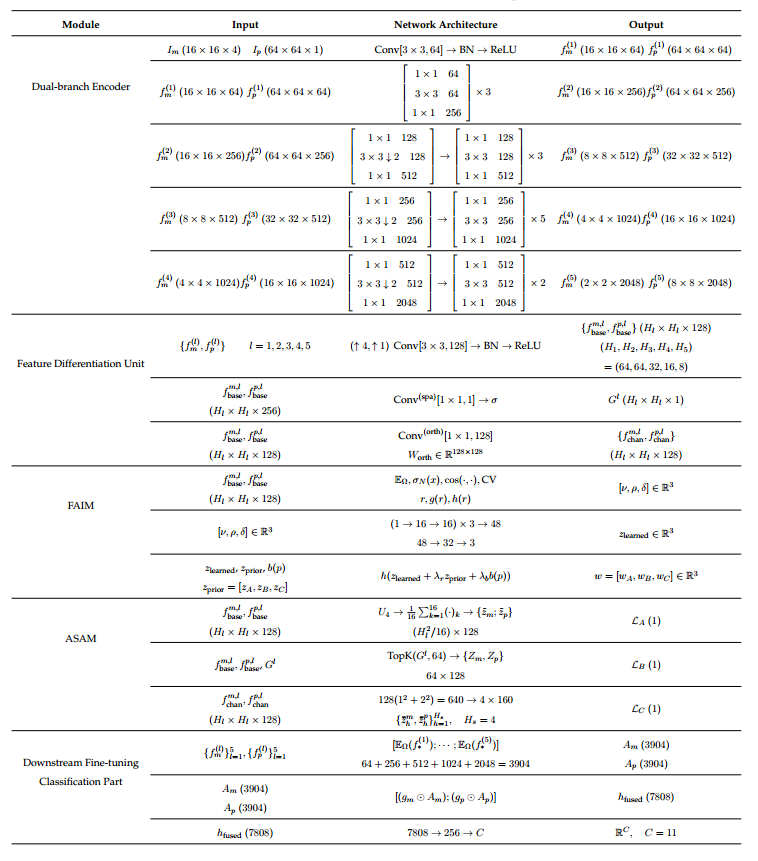

# FEAAN
Our code is released [here](https://github.com/LiuShutong04/FEAAN-main) !

## Network Architecture Details

The original manuscript describes the design of each module separately but does not adequately explain how features pass between modules or how the modules work together during training. We therefore provide a detailed explanation of the architectural components and their relationships.

The network consists of a dual-branch encoder, feature differentiation units, FAIM, ASAM, and a downstream classification component for fine-tuning. During pretraining, attribute inference and attribute-specific alignment support the learning of cross-modal representations. During fine-tuning, the pretrained encoder performs joint classification under the supervision of a small set of labeled samples.

The table lists the inputs, processing steps, and outputs of each module using multispectral patches of size $16 \times 16 \times 4$ and panchromatic patches of size $64 \times 64 \times 1$ as examples. Feature map sizes are given as height $\times$ width $\times$ number of channels.

### Dual-branch Encoder

Both branches use ResNet-50 with a modified input layer, and their parameters are learned independently. The network extracts features from the initial convolutional layer and the ends of the four residual stages, then passes these five levels of features to the corresponding feature differentiation units. Each group of three convolution rows in the table represents one residual bottleneck block. The number outside the parentheses gives its repeat count, and \(\downarrow2\) indicates a convolution with a stride of 2 that halves the spatial dimensions.

### Feature Differentiation Unit

This unit receives features from both modalities at the same level and prepares inputs for attribute inference and the different alignment paths. The multispectral features are first upsampled to match the spatial size of the panchromatic features. In the table, \((\uparrow4,\uparrow1)\) indicates that both the height and width of the multispectral features are multiplied by 4, while the panchromatic features retain their original size. The features of each modality then pass through a \(3\times3\) convolution, batch normalization, and an activation operation to obtain 128-channel base features \(f_{\mathrm{base}}^{m,l}\) and \(f_{\mathrm{base}}^{p,l}\). The base features from the two modalities are concatenated and passed through a spatial branch to generate a shared guidance map \(G^l\), which determines the locations on which structural alignment focuses. The base features also pass separately through \(1\times1\) convolutions with an orthogonality constraint to produce channel features \(f_{\mathrm{chan}}^{m,l}\) and \(f_{\mathrm{chan}}^{p,l}\) for semantic alignment.

### FAIM

This module determines the weights of the three alignment approaches from the base features at the current level. It first computes the local variation indicator \(\nu\), the cross-modal structural similarity indicator \(\rho\), and the channel diversity indicator \(\delta\). These indicators provide the basis for inferring texture, structure, and semantic attributes, respectively. The three indicators then pass through a prediction branch to produce learned scores for the three paths. These scores are combined with the dominance prior and attribute evolution bias, then passed through Gumbel-Softmax to obtain the path weights \(w_A,w_B,w_C\).

### ASAM

This module contains three alignment paths for texture, structure, and semantics, which compute \(\mathcal L_A\), \(\mathcal L_B\), and \(\mathcal L_C\), respectively. The texture path divides the base features into non-overlapping \(4\times4\) regions and averages the features within each region to obtain a 128-dimensional regional representation. It then applies contrastive learning to corresponding regions across the two modalities. In the table entry \((H_l^2/16)\times128\), the two dimensions represent the number of regions and the feature dimension of each region, respectively. The structure path selects the 64 locations with the highest responses in the shared guidance map \(G^l\). Features at the same locations are extracted from both modalities to form two \(64\times128\) feature matrices. This path constrains both the feature similarity at corresponding locations and the feature relationships among these locations. The semantic path pools the channel features of each modality to \(1\times1\) and \(2\times2\), then concatenates the results to obtain a \(128(1^2+2^2)=640\)-dimensional representation. This representation is divided into four 160-dimensional subspaces for semantic alignment. When the similarity between features from the two modalities is high, a relaxation mechanism weakens the constraint that pulls them closer together. The three path losses are combined using the weights produced by FAIM to form the pretraining loss function.

### Downstream Fine-tuning for Classification

After pretraining, the dual-branch encoder is used for supervised classification. Features from the five levels of each encoder are globally average-pooled and concatenated to obtain 3904-dimensional vectors \(A_m\) and \(A_p\). Learnable gating coefficients \(g_m\) and \(g_p\) adjust these vectors, which are then concatenated into a 7808-dimensional fused representation \(h_{\mathrm{fused}}\). A \(7808\rightarrow256\rightarrow C\) classifier outputs the classification scores, with \(C=11\) in the table. During fine-tuning, the encoders and classifier are jointly updated using a small number of labeled samples.
